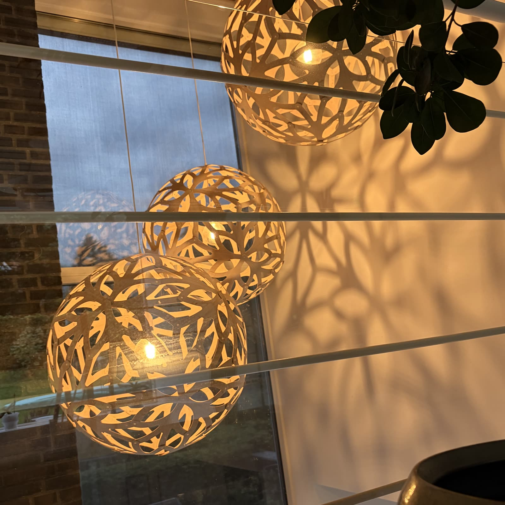
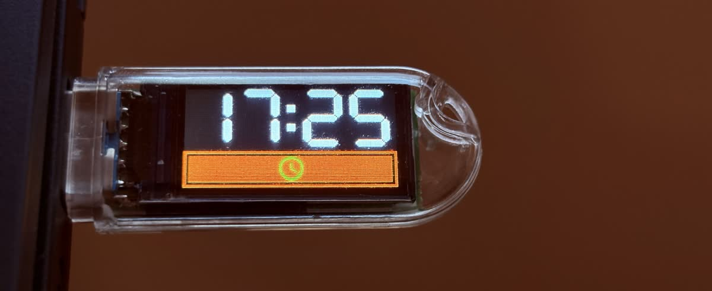
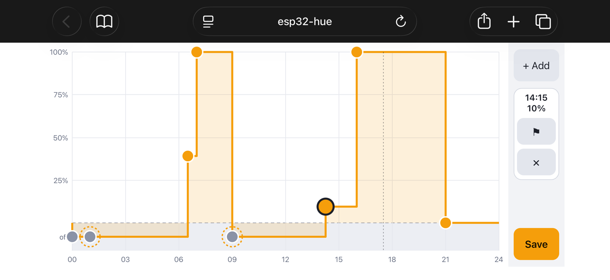

# esp32_hue

Rust firmware for the LilyGO T-Dongle-S3 (ESP32): schedules and dims Philips Hue lights over BLE, no bridge.

### David Trubridge with no Hue Bridge

*A self-contained art installation: three David Trubridge Floral lamps with
Philips Hue bulbs, a €20 USB stick, and a schedule that plays out every day
without a hub, an app or a cloud service. Press the button to override it.*



### BLE Central

Each lamp holds a Philips Hue Bluetooth bulb, so it can be controlled over BLE
without a Hue bridge. The only thing that controls them is a **LilyGO
T-Dongle-S3** (ESP32-S3), which plugs into any USB power source.



The dongle is the BLE central and the lights are peripherals; everything is
controlled by the dongle itself. The display shows the time and the light level,
and the BOOT button is the only physical control:

- **Click**: toggle the lights between off and full.
- **Hold**: ramp the brightness; the direction alternates from one hold to the
  next.
- **Double-click**: switch the automation on or off. The clock icon on the bar
  shows that it is on.

### Automation

The **automation** follows a daily schedule, edited on a web page served by the
dongle (see [Web interface](#web-interface)). A manual change overrides it: the
next entry is carried out only if the lights are still where the previous entry
left them (on track), or if that entry is marked forced.



### About this project

The project is written in Rust (`no_std`, Embassy, `esp-hal`, `trouble-host`) and
is split into two crates:

| Crate | What it is |
| --- | --- |
| `crates/hue-ble` | The communication with the lights: scanning, pairing, stored bonds, one-off writes and a long-lived "session". No ESP-specific code; generic over any `trouble-host` controller. |
| `crates/tdongle` | The firmware for the T-Dongle-S3: display, LED, button, flash storage, serial console, WiFi, and the glue that drives `hue-ble`. |

> **Status in one paragraph.** Three lights are paired and work together:
> pairing, reconnecting from the stored bonds after a reboot, reading the lights'
> state, switching and dimming all three at once from the button, the display,
> and the schedule automation with its web page. Pairing only works while a
> light advertises that it accepts pairing, which the Hue app's "Make
> Discoverable" brings about; see
> [Pairing: what the lights require](#pairing-what-the-lights-require) for what
> was found out, since that cost a lot of time.

The Hue BLE protocol is **unofficial**: it was worked out by others and checked
against our own lights. It may change with a firmware update. The Python library
[HueBLE](https://github.com/flip-dots/HueBLE) (MIT) was our main reference.

---

## Contents

- [Hardware](#hardware)
- [Build, flash, run](#build-flash-run)
- [Web interface](#web-interface)
- [What is in the repository](#what-is-in-the-repository)
- [Pairing: what the lights require](#pairing-what-the-lights-require)
- [Protocol notes](#protocol-notes)
- [Known limitations](#known-limitations)

---

## Hardware

- **LilyGO T-Dongle-S3**: ESP32-S3, 16 MB flash, 0.96" ST7735 display (80x160),
  one APA102 RGB LED, one BOOT button, USB-A plug.
- Pins used by the firmware (from `crates/tdongle/src/main.rs`):

  | Function | Pin |
  | --- | --- |
  | Display SCK / MOSI / CS / DC / RST | GPIO5 / GPIO3 / GPIO4 / GPIO2 / GPIO1 |
  | Display backlight (PWM, active low) | GPIO38 |
  | APA102 LED clock / data | GPIO39 / GPIO40 |
  | BOOT button (pull-up, low when pressed) | GPIO0 |

- **Lights tested:** three "Hue filament bulb" lights (model string `LWO007`,
  firmware `1.163.1`, manufacturer string "Signify Netherlands B.V."). They are
  already set up in the Hue app, and they can be paired with several devices at
  once.

## Build, flash, run

Prerequisites: the Espressif Rust toolchain (`espup`, which provides the `esp`
toolchain pinned in `rust-toolchain.toml`) and `espflash`.

```sh
# Build the firmware (the default workspace member is crates/tdongle)
cargo build --release

# Flash and open the monitor (the cargo runner calls espflash with the
# partition table in crates/tdongle/partitions.csv)
cargo run --release

# Or flash by hand
espflash flash --chip esp32s3 \
    --partition-table crates/tdongle/partitions.csv \
    target/xtensa-esp32s3-none-elf/release/tdongle
```

The partition table must be flashed together with the firmware, because the
`settings` partition holds the stored WiFi settings and BLE bonds.

The `hue-ble` library also type-checks on the host, which is handy for quick
feedback (the repo's cargo config otherwise forces the ESP target):

```sh
cargo +stable check -p hue-ble --target x86_64-pc-windows-msvc
```

Versions in use: Rust `esp` toolchain, `esp-hal` 1.2, `esp-radio` 1.0.0-beta.1,
`trouble-host` 0.7.0 (the last release whose `bt-hci` 0.9 matches `esp-radio`),
Embassy.

### Serial console

The dongle's USB Serial/JTAG port is both the log and a command console. Type one
command per line (the leading `/` is optional). Logging uses `ESP_LOG=info`.

| Command | What it does |
| --- | --- |
| `/ssid <name>`, `/password <pw>`, `/restart` | Store WiFi settings in flash; restart to use them. |
| `/status` | Show the stored WiFi network (never the password). |
| `/scan [secs]` | Scan for `secs` (default 8) seconds for Hue lights, listing each with a number as soon as it is heard. |
| `/watch [secs]` | Scan for `secs` (default 120) seconds and log every change in a light's advertisement as it happens, with the time since the start. |
| `/pair <n>` | Pair with light `n` from the last scan (the light must accept pairing, see below) and store the bond. |
| `/autopair [all]` | For up to a minute, scan and pair with every light not paired yet as soon as it advertises that it accepts pairing; press "Make Discoverable" in the Hue app meanwhile. `all` pairs the already paired lights anew too. |
| `/log [on\|off]` | Log everything the lights offer and send: on each connection, every service and characteristic with its properties and readable value, then every notification and indication as it arrives (they are subscribed to). The session reconnects to apply it; not stored, so it is off after a restart. |
| `/automate [on\|off]` | Switch automation on or off (toggle if no argument); stored in flash. Turning it on needs at least two schedule times. |
| `/schedule [list]` | List the automation schedule. |
| `/schedule set HH:MM <1-254\|off> [force]` | Add a time with the brightness to set then (`off` switches off), or overwrite the entry at that time. Up to 8 times. `force` sets it even if the lights were changed by hand. |
| `/schedule remove HH:MM`, `/schedule clear` | Remove one time, or all. Automation goes off if fewer than two are left. |
| `/lights` | List the stored bonds. |
| `/forget [n]` | Delete the stored bond of light `n` (from `/lights`), or all bonds if no number is given. **Destructive**: the dongle loses the keys and there is no backup. |
| `/power on\|off [n]`, `/bright <1-254> [n]` | Switch or dim paired light `n` (from `/lights`; the first if left out). |

Every log line carries the milliseconds since boot, and each console command is
echoed as `> /command`.

WiFi is started with DHCP, SNTP for the clock, and the web interface below. Its
status is only logged; on the display, the clock icon is green while WiFi is up.

### Web interface

Once the dongle is on WiFi, open `http://esp32-hue/` (the hostname it sends with
DHCP; use its IP address if your router does not register it) from a phone or
computer on the same network. The page edits the automation schedule as a
full-screen step graph:

- **Drag a point** left or right to change its time (5-minute steps) and up or
  down to change its brightness. The dashed strip at the bottom is **off**:
  dragging a point into it switches that time off, and just above it is the
  lowest dim level.
- **Tap a point** to select it. The box in the middle of the side column, greyed
  out until something is selected, shows its time and level, and has the
  **forced** flag (a dashed ring on the graph) and **delete**. Tapping empty
  graph deselects.
- **Add** (top of the side column) inserts a point in the middle of the largest
  gap; **Save** (bottom) writes the schedule to flash. Nothing changes on the
  dongle until Save. Between 2 and 8 times are kept, and times cannot repeat.

Automation itself is not switched on the page; use the BOOT button double
click or `/automate`.

The page is one self-contained file, `web/index.html`, embedded in the firmware
(`include_str!`). It talks to a two-command API; opened from anywhere else (a
file, or another web server) it falls back to the browser's `localStorage`, which
is how it can be tried without the dongle.

| Request | Meaning |
|---|---|
| `GET /api/schedule` | `{"automate":true,"entries":[{"minute":390,"dim":60,"forced":false}, ...]}`; `minute` is minutes since midnight (local time), `dim` is 1 to 254 or `null` for off. |
| `PUT /api/schedule` | Replaces the schedule with the `entries` in the body (same format; `automate` is ignored). `204` on success, `400` with a message if the entries are invalid. |

There is no authentication: anyone on the network can read and change the
schedule. Connections are served one at a time on port 80.

---

## What is in the repository

### Repository layout

```
Cargo.toml                 workspace; shared dependency versions; build profiles
.cargo/config.toml         xtensa target, build-std, espflash runner
rust-toolchain.toml        channel = "esp"
crates/
  hue-ble/src/
    lib.rs                 public API, HueController trait, constants, Addr, fail()
    protocol.rs            UUIDs, value clamps, advertisement parsing, pairing_open()
    bond.rs                Bond type, to/from trouble-host BondInformation, add/remove
    finder.rs              Finder (scan results), scan(), watch()
    client.rs              connect, pair, open (encrypted link), set_power, set_brightness
    session.rs             Session channels, run_session() (one connection per light)
  tdongle/
    partitions.csv         flash layout
    build.rs               linker script and helper messages
    src/main.rs            startup, WiFi, serial console, UI state machine
    src/ble.rs             BLE task: runs the host, carries out console commands
    src/light.rs           BOOT-button dimmer logic, and the LIGHT session
    src/screen.rs          progress bar with the clock icon over it, the clock
    src/schedule.rs        the automation schedule (time, dim, forced); has unit tests
    src/clock.rs           SNTP task (pool.ntp.org, hourly) and the current time
    src/web.rs             web server: the page, GET/PUT /api/schedule
    src/localtime.rs       Unix time to Copenhagen time, with summer time; has unit tests
    src/aafont.rs          the anti-aliased bitmap icon type
    src/fonts.rs           generated by tools/fontgen; don't edit
    src/led.rs             APA102 LED driver (bit-banged); only used to switch the LED off at boot
    src/settings.rs        WiFi record, bond and automation flag storage in flash
web/
  index.html               the schedule editor page, embedded into the firmware
tools/
  fontgen/                 PC tool (not in the workspace): renders icons into fonts.rs
```

### The user experience (`crates/tdongle`)

1. At boot the dongle **connects to the paired lights** (up to three, one after
   the other) and keeps the connections open. A light that drops or can't be
   reached is tried again every 5 s. If no light can be reached at all, the
   session is retried after 60 s. The screen is **always on** and the dongle's
   LED is not used (it is switched off once at boot, as it may power up lit).
2. Until the first light has connected the progress bar is empty and gray. Then
   the dongle **reads its real on/off state and brightness** and the bar turns
   **orange** and fills to that level. The other lights join as they connect
   and adopt the level the session has reached.
3. Once the lights are connected, the **BOOT button controls them at once**;
   there is no wake-up press. Before that, presses do nothing.
4. The button:
   - **Click**: toggle between off (0) and full (254). It takes effect 300 ms
     after the release, once it is clear no second press follows.
   - **Double-click**: switch automation on or off, but only while the lights
     and WiFi are both connected.
   - **Hold** (0.5 s): ramp the brightness for as long as the button is held
     (steps of 2 every 30 ms, about four seconds end to end). The direction
     alternates from one hold to the next. From off a hold always brightens, from
     full it always dims, and a hold never switches the light off.

The display is 160x80, in two rows:

- **Top**, 48 px high: the **clock**, the Copenhagen time `HH:MM` in white
  seven-segment digits (the `eg-seven-segment` crate: digits 30x48 px, segments
  6 px, 150 px wide in all), centered (`--:--` until the first SNTP answer).
- **Bottom**: the progress bar's box, 160x28 at (0, 52), border 2 px, gap 2 px.
  Until the first light has answered, the box is empty and gray. While
  automation is on, the Material Design Icons
  **clock-outline** icon (U+F0150) is drawn over the middle of the bar, green
  when WiFi is up and light gray when not. It is drawn into the bar, blending
  with what is under it (orange, black or the border), so it is redrawn
  together with the bar.

### Automation

The schedule is a daily cycle of entries (time, dim or off, forced), so the
entry before the first is the last. When the time of an entry comes, and
automation is on, the lights are compared with what the **previous** entry set.
If they match (nobody has touched them), the entry is carried out; if not, it
is skipped unless it is `forced`. Off counts as level 0.

- The dongle **follows the first light** (the first paired light, `/lights`
  number 0): it subscribes to that light's control characteristic
  (`932c32bd-0007-...`), which notifies the light's state on every change, from
  the Hue app too (seen in `/log` output as `01 01 pp 02 01 bb`: power and
  brightness). The bar and the button's level follow it. The other lights are
  not followed, so the rule uses the first light's level alone. The light also
  reports the dongle's own changes back, so for a second after a button press or
  an automation step reports are ignored.
- At an entry's time the dongle compares that level with the previous entry's
  and decides.
- The first time comes from SNTP; entries before it is known are not carried
  out. Nothing is shown while automation is off.

### Icons

The clock icon is from Material Design Icons (Apache 2.0, see
`tools/fontgen/fonts/MaterialDesignIcons-LICENSE.txt`), rendered anti-aliased:
4 bits of coverage per pixel, blended into the background.
`crates/tdongle/src/fonts.rs` is generated and must not be edited by hand. To
change the icon or its size, edit the `ICONS` list in
`tools/fontgen/src/main.rs` (name, code point, size) and run, from
`tools/fontgen`:

```
cargo +stable run --target x86_64-pc-windows-msvc
```

The tool is outside the firmware workspace and runs on the PC; the `--target`
overrides the repository's xtensa `.cargo/config.toml`. It rewrites `fonts.rs`
and prints each icon as ASCII art, to check that it is the one wanted, with its
size in pixels. Rebuild the firmware afterwards. The icon font itself is
`tools/fontgen/fonts/MaterialDesignIcons.ttf`, from the Templarian
`MaterialDesign-Webfont` repository.

### Flash layout (`partitions.csv`)

| Name | Offset | Size | Purpose |
| --- | --- | --- | --- |
| `nvs` | `0x9000` | `0x6000` | Standard. |
| `phy_init` | `0xf000` | `0x1000` | Standard. |
| `factory` | `0x10000` | `0x400000` (4 MB) | The application. |
| `settings` | `0x410000` | `0x10000` (64 KB) | WiFi settings, BLE bonds and the automation flag. |

The `settings` partition uses **one sector per record**, so saving one never
erases the other. Each record is a magic value, the fields, and a CRC-32; a
record cut short by a power loss fails its CRC and counts as "nothing stored".

- **Sector 0**: WiFi SSID and password (magic `TDS1`).
- **Sector 1**: BLE bonds (magic `TDB1`), up to 8, 39 bytes each: flags, the
  light's address, the long-term key, and the identity resolving key.
- **Sector 2**: the automation flag (magic `TDA1`).
- **Sector 3**: the automation schedule (magic `TDC1`), up to 8 entries of 4 bytes.

### The `hue-ble` library

`hue-ble` is `no_std`, built on `trouble-host` 0.7, and generic over the
controller through the `HueController` trait (which collects the HCI commands the
library needs). It uses the `log` facade and has no global state: the caller owns
a `Finder` and a `Session`.

The caller builds and runs the `trouble-host` stack and passes the `Finder` as
the event handler to `Runner::run_with_handler`. Then:

| Item | Purpose |
| --- | --- |
| `scan(stack, &finder, time)` | Clear the finder, scan, leave the lights heard in it. |
| `watch(stack, &finder, time, changed)` | Like `scan`, calling `changed` whenever a light is first heard or its service data changes. |
| `Finder`, `Found` | Lights heard: address, RSSI, service data. |
| `pair(stack, address)` | Connect, pair, wait 2 s for the key exchange to finish, disconnect, and return the `Bond` for the caller to store. |
| `Bond`, `add_bonds`, `remove_bonds` | Keys to keep; give stored bonds back to the stack at startup. |
| `set_power`, `set_brightness` | One-off writes: connect, encrypt with the stored bond, write, disconnect; up to 2 attempts. |
| `run_session(stack, &addresses, &session)` | Keep one connection per light (up to `MAX_LIGHTS` = 3) open, reading the first light's state, then forwarding each new level to all. |
| `Session`, `Link` | The session's channels: `level` (a `Watch`, to every light), `stop`, and `link` (Connecting, Connected(level), Disconnected). |
| `protocol` | UUIDs, `brightness_byte`, `hue_service_data` (advertisement parser), `pairing_open` (the pairing flag). |

Timeouts: 20 s per connection attempt, 30 s for pairing or encrypting, up to 2
attempts (1 s apart), because the lights sometimes drop the first connection. In
the session, lights connect one at a time under a lock, so a light's timeout
doesn't run while it waits for another light's attempt.

Failures are logged where they happen and returned as `Err(())`; a proper error
type is still to do.

### What has been confirmed on hardware (three lights)

- Pairing with each of the three lights, with the bonds stored in flash and
  surviving a reboot.
- Reconnecting from the stored bonds after a reboot, encrypting the links,
  writing power and brightness, and reading the lights' state.
- The whole connect and adjust flow described above with all three lights at
  once, including dimming with a hold. The ESP32-S3 controller holds
  the three connections.

---

## Pairing: what the lights require

For a long time two of the three lights answered every Pairing Request from the
dongle with SMP "Pairing Not Supported" (`0x05`), while the same lights accepted
a Windows PC within a second. What was found, by trying one
thing at a time with a single `/pair` per try:

- **The lights advertise whether they accept pairing.** Byte 4 of the `0xFE0F`
  service data is a flag byte. While its bit `0x01` is set, a light accepts the
  dongle's Pairing Request as it is; while it is clear, the light refuses with
  `0x05`. The **"Make Discoverable"** button in the Hue app (Settings → Voice
  assistants → Amazon Alexa → Make Discoverable) sets the bit, but only on the
  lights the app is in contact with at that moment: in our runs sometimes one light, sometimes two, rarely all three,
  and the bit stayed set for minutes. Bit `0x02` comes and goes for reasons not
  known. `/watch` shows the byte change as it happens; `/scan` snapshots missed it.
- **Nothing on the dongle's side mattered.** Tried and refused while the bit was
  clear, accepted while it was set: IO capability (all five values), the AuthReq
  byte (bonding only, with MITM, with CT2, legacy without Secure Connections),
  key distribution (none, with signing, all), a random static address instead of
  the public one, reading a characteristic first to make the light ask for
  security, and waiting hours between tries. (The request fields were varied
  with a temporarily patched `trouble-host`; that patch is gone again.)
- **The Windows PC did not disprove this.** It paired within a second every time
  because Windows had a bond with each light already (the lights keep theirs when
  Windows "removes" the device), and a known peer re-pairs.
- **Bonds were lost once:** three freshly made bonds were rejected by the lights
  ("PIN or Key Missing") minutes later, with no contact in between. `pair` used
  to disconnect the moment the stack reported the pairing complete, which is also
  the moment the stack queues the dongle's own identity keys for the light. It now
  waits 2 s before disconnecting; since then every bond has held across reboots.
  Whether the early disconnect was the cause is not proven.

So: press "Make Discoverable", run `/autopair`, and if a light never shows the
bit, get the app in contact with that light and press again.

---

## Protocol notes

What the firmware relies on (partly from HueBLE, partly confirmed on our lights):

- Lights advertise the 16-bit service `0xFE0F` (Philips) with **service data**
  that ends with part of the light's Zigbee address. This is how the dongle
  recognises a light during a scan. Our lights send
  `06 18 ff ff <flags> 03 <4 bytes of Zigbee address>`; byte 4 is the flag byte
  described above (`0x01`: accepts pairing).
- Control service: `932c32bd-0000-47a2-835a-a8d455b859dd`.
  - Power, `932c32bd-0002-...`: one byte, `0` off, `1` on.
  - Brightness, `932c32bd-0003-...`: one byte, `1` to `254`.
  - Both need an **encrypted, bonded** link. Reads and writes fail without one.
- A readable vendor characteristic, `97fe6561-0001-4f62-86e9-b71ee2da3d22`,
  returns the light's Zigbee address.
- Writing a brightness to a light that is off does not switch it on, so the
  firmware writes the brightness first and then power on, to avoid a flash at the
  old brightness.

## Known limitations

- At most three lights (`MAX_LIGHTS`); the session uses the first three stored
  bonds.
- The same schedule every day: no weekdays, weekends or dates.
- All bonded lights follow the same schedule; they cannot be scheduled
  individually.
- `hue-ble` returns `Result<_, ()>`, with failures logged; no proper error type.
- Few automated tests: only `schedule.rs` and `localtime.rs` have unit tests.
  Protocol code (advertisement parsing, value encoding) and the flash record
  encoding could be tested on the host.
- The BLE task has been seen to go silent after connect timeouts (only a chip
  reset recovered it). Retries made it stop appearing, but there is no watchdog.
- `/forget` deletes bonds without a backup.

## Licence

MIT, see [LICENSE](LICENSE). The icon font has its own licence, see
`tools/fontgen/fonts/MaterialDesignIcons-LICENSE.txt`.
